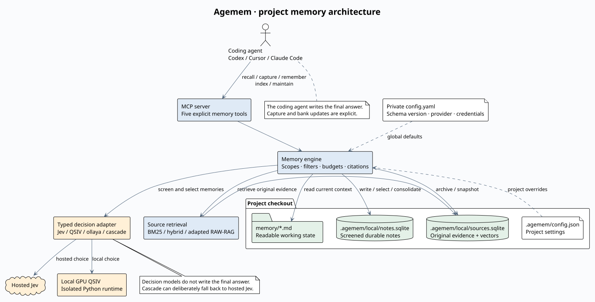
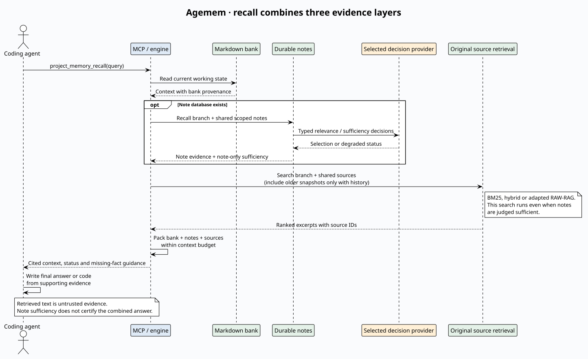

# MCP product and implementation boundaries

The intended product is a coding-project memory MCP with readable working state,
screened durable notes and cited original evidence. The MCP interface is the part
agents use; retrieval algorithms, storage libraries and decision models are
implementation choices. This is an experimental implementation, not yet a
versioned compatibility commitment or a published release.

The [PlantUML sources](diagrams/README.md) are editable and rendered locally.

Current public tools are `project_memory_recall`, `project_memory_remember`,
`project_memory_capture`, `project_memory_index` and `project_memory_maintain`.
Capture/remember calls are explicit; the server does not automatically record
conversations. MCP configuration is project-scoped and installed explicitly.

Current implementation:

| Responsibility | Implementation |
|---|---|
| Working state | Markdown memory bank |
| Persistence | Local SQLite sources/vectors and internal note store |
| Source retrieval | Hybrid/BM25 or bundled adapted RAW-RAG with local providers |
| Note write/retrieval/maintenance | Internal Writer, Retriever and Consolidator adapted from jev-mem |
| Typed model decisions | Jev by default; QSIV, local ollaya or cascade optional |
| Final answer or code | The calling coding agent |

RAW-RAG changes source retrieval only. It operates on branch-filtered source
records selected by agemem; it does not own the note database. Jev/QSIV screen
injection and temporary status, classify notes, judge relations/consolidation,
select relevant notes and assess note evidence. Those are typed decisions, not
final answer generation. Deterministic code also enforces scopes, source linkage,
secret filters, budgets and pending-note visibility.

The live MCP now owns its note engine in `agemem/notes/`, adapted from
`jevmem==0.4.0`. Full MIT notice and original source hashes ship with the package.
The external package is optional (`.[compatibility]`) for upstream database
compatibility tests only. Hosted decisions use agemem's existing bounded
Jev adapter; no upstream global settings, hooks or service are loaded. Only the
local exact matrix vector index is supported by this internal note engine.

SQLite schema, note IDs, pending flags, source linkage and prompt thresholds are
preserved. A roundtrip test opens an upstream database, checks all table contents,
writes with the adapted engine and reopens with upstream. This is a bounded
compatibility check, not a promise for every historical jev-mem version.

For a standalone release, separate storage, note policy, typed-decider and source
retriever interfaces; retain the behavioral tests as migration contracts. Preserve
existing note IDs, source citations, project/branch scopes, pending flags and
schema compatibility, or provide explicit migrations. Shared evidence types, BM25, chunking and context budgeting live in
`agemem.evidence`; the live RAW adapter lives in `agemem.raw_rag`. The historical
comparison harness and its old `amem` command have been removed.
Keep all model/provider dependencies optional where feasible; never silently
switch paid/local providers or change the default backend during setup.

RAW-RAG's needed token-window/dense/rerank pipeline is now adapted in
`agemem.raw_rag`, with its MIT notice and adaptation details bundled in the wheel.
No upstream checkout is required. Per-source windows
provide exact source IDs; this is a deliberate change from conversation windows.
Dependency/model licenses and hosted service terms remain separate.
See THIRD_PARTY.md. Publishing remains separate work.

## Recall evidence flow

## Concurrent processes and worktrees

Git worktrees of one project share the main checkout's untracked `.agemem/local/` store, so several agent
sessions (separate processes) can use `sources.sqlite` and `notes.sqlite` at the same time.

- Every read-write connection comes from `agemem.sqlite_util.connect`: WAL journal, `synchronous=NORMAL`,
  a 30 s busy timeout and autocommit mode. If WAL cannot be enabled (read-only or unsupported file system)
  the default journal is kept. The prompt hook opens its own read-only connection with a 0.2 s timeout and
  never waits on a writer.
- Writes go through `Connection.tx()`, a re-entrant `BEGIN IMMEDIATE` ... `COMMIT`/`ROLLBACK` block. The write
  lock is taken up front, read-then-write sequences (note id allocation, counters, migrations, the
  duplicate-pending check for synthesis items) run inside it, and slow work (embedding, model calls, file
  reading) happens before or after the block, never inside it.
- The vector index reloads when `PRAGMA data_version` shows that another process committed.
- `.agemem/local` must be on a local file system: SQLite WAL needs shared memory and file locking that
  network file systems (NFS, SMB, some sync folders) do not provide reliably. `-wal`, `-shm` and `-journal`
  files are git-ignored together with the directory.

Known limitations:

- Two worktrees on the same detached HEAD share the branch identity `detached:<commit>`, so they share one
  branch scope and one source manifest. Each `index` replaces that manifest with its own working tree's files
  (last writer wins), and notes written in one are visible in the other. Use a named branch per worktree.
- Two processes can run consolidation at the same moment and judge the same notes twice (duplicated model
  calls, idempotent flags and edges). There is no consolidation lease.
- Each process keeps an in-memory note index that is rebuilt after another process's commit; very frequent
  writers make other processes reload more often.
