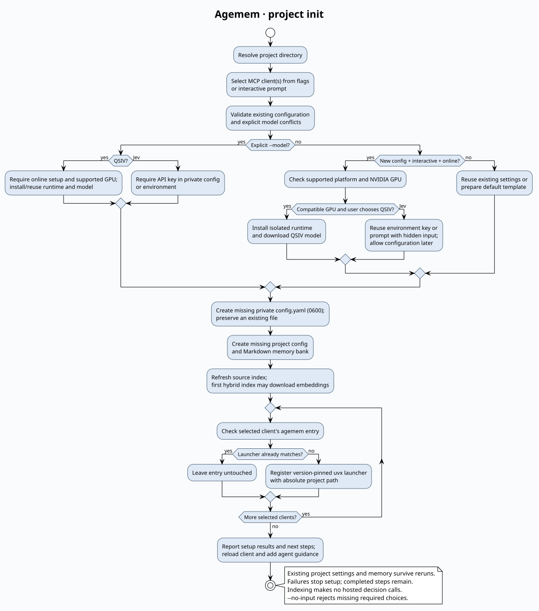

# Installation and project setup

## Install from PyPI

Requires Python 3.12–3.14 and Git. Python 3.15 is currently excluded because
ONNX Runtime (required by FastEmbed) has no matching wheels. Use the development installation below when working from source.

With [uv](https://docs.astral.sh/uv/), run the CLI and MCP server using `uvx`:

```bash
uvx --python 3.12 agemem@0.1.0 --help
```

No separate package-install step is needed. `uvx` prepares an isolated environment
on first use and reuses its cache. It can provision Python 3.12 when needed.
The first run requires network access; an offline launch needs the tool and
retrieval-model caches already populated. The explicit version pin keeps the
application release fixed; change it deliberately when upgrading.

Project databases and the private YAML config live outside this cached tool
environment, so clearing uv's tool cache does not remove project memory.
See [uv's tool guide](https://docs.astral.sh/uv/guides/tools/) for cache behavior.

The shell examples here use POSIX syntax. On Windows, find the absolute uvx
executable with `(Get-Command uvx).Source` and use JSON configuration or native
client commands. QSIV automatic GPU setup currently supports Linux x86_64 only.

### Persistent installation alternative

If you prefer an `agemem` command on your PATH:

```bash
uv tool install --python 3.12 'agemem==0.1.0'
agemem --help
```

If it is not found, run `uv tool update-shell` and open a new terminal.
A pip environment is also supported:

```bash
python3.12 -m venv /absolute/path/to/agemem-venv
/absolute/path/to/agemem-venv/bin/python -m pip install 'agemem==0.1.0'
```

For these alternatives, replace `uvx --python 3.12 agemem@0.1.0` below with the
installed `agemem` executable. For MCP, use its absolute path; on Windows the
virtual-environment executable is `Scripts/agemem.exe`.

## One-command project setup

From the target project's Git repository:

```bash
uvx --python 3.12 agemem@0.1.0 project init
```

Choose `codex`, `cursor` or `claude-code` at the prompt.

### Unattended setup for agents and scripts

Supply the provider and all desired clients explicitly:

```bash
uvx --python 3.12 agemem@0.1.0 project init --model qsiv --mcp cursor claude --no-input
```

For hosted Jev, first supply a key in private configuration or the environment
(`AGEMEM_JEV_API_KEY`, `TYPESAFE_API_KEY` or `JEV_API_KEY`), then run:

```bash
uvx --python 3.12 agemem@0.1.0 project init --model jev --mcp claude codex --no-input
```

`--model` accepts `jev` or `qsiv`. `--mcp` accepts one or more of `cursor`,
`claude` (Claude Code), `claude-code` and `codex`; duplicate clients are ignored.
`--client` remains a single-client alternative and cannot be combined with `--mcp`.
With explicit model and clients, setup never prompts. `--no-input` additionally
ensures missing choices fail instead of prompting: clients are required, and a
model is required when creating user configuration. Existing user settings can
be reused without `--model`.

Explicit Jev setup requires a key and does not copy environment credentials into
YAML. Explicit QSIV setup installs the runtime/model and fails on unsupported
hardware; it cannot be combined with `--offline`. Existing provider settings and
project overrides must agree with `--model`; conflicts fail with instructions
rather than silently replacing them. Explicit QSIV installation reuses existing
runtime/download caches. Configuring multiple clients runs registration in order;
if one fails, earlier registrations remain and setup can be rerun.

### Setup behavior

This ensures a private user YAML configuration exists, creates missing project
configuration and memory-bank files, refreshes the index, and registers the
project MCP server for the selected client. Existing configuration and bank files
are preserved. Matching MCP entries are left untouched; missing or different
Agemem entries are created or updated, preserving unrelated entries.
Codex uses user configuration fixed to this project and requires its CLI on PATH;
Cursor and Claude Code use project configuration. No Node.js/npm is needed.

When creating a user configuration interactively, setup checks for Linux x86_64
and an NVIDIA GPU with compute capability 8.9+. On supported hardware it offers
hosted `jev` (the default) or local `qsiv`. Selecting QSIV installs an isolated
GPU runtime and downloads several GB before saving `default_provider: qsiv`.
Unsupported hardware skips this choice and uses Jev. No CPU QSIV is installed.

For Jev, setup requests the API key with hidden input and saves it in the private
YAML file (mode `0600`). Press Enter to configure it later. An existing environment
key is reused without prompting or copying it into YAML. Keys never go into
project files, MCP configuration or setup output. Existing user configurations
are preserved and do not trigger provider prompts. Explicit `--model qsiv` still
ensures the local runtime and model are installed.

Without an explicit `--model`, non-interactive runs and `--offline` skip provider
prompts and installation, creating a default template if needed. Configure the
provider separately below. `--no-input` requires a model for new user configuration.
Setup and indexing make no hosted decision calls. The default embedding model
downloads on first indexing unless offline. Restart/reload the client and enable
the server after setup. Agent instructions are still added separately below.

`--project` defaults to the current directory; use `--project ../other-project`
before `project init` to target another checkout. `--retrieval` and `--embedder`
after `project init` affect only newly created project configuration. For a
contract smoke test without model downloads or hosted decisions:

```bash
uvx --python 3.12 agemem@0.1.0 --offline project init --client cursor --retrieval bm25 --embedder hash
```

Hash embeddings are only for testing. Re-running setup refreshes the index;
if a later step fails, completed steps remain and you can fix the issue and rerun.
Use the individual commands below when you only want one setup step. The
`mcp-install --dry-run` option previews registration without changing client files.

### Setup flow



[Editable PlantUML source and rendering instructions](diagrams/README.md).

## Configure and initialize a project

```bash
uvx --python 3.12 agemem@0.1.0 config init
```

Set `providers.jev.api_key` in the private user `config.yaml`, normally
`~/.config/agemem/config.yaml`. See [configuration and precedence](CONFIGURATION.md)
for XDG locations and `AGEMEM_CONFIG`. Never put credentials in project or MCP
configuration. Supported environment credentials remain optional overrides.

From the target project's Git repository:

```bash
uvx --python 3.12 agemem@0.1.0 --project . init
uvx --python 3.12 agemem@0.1.0 --project . index
uvx --python 3.12 agemem@0.1.0 --project . doctor
```

`--project .` resolves relative to the process working directory; omitting
`--project` also uses the current directory. Other relative paths, such as
`--project ../another-project`, work the same way.

`init` preserves existing files. Review `.agemem/config.json`, `.agemem/.gitignore`
and the `memory/` bank; commit config/bank when appropriate. Generated databases,
source snapshots and vectors stay under ignored `.agemem/local/`. The default
embedder downloads on first use and then runs locally. Indexing makes no hosted
decision calls; `remember`, note-aware recall and maintenance can call Jev.

## MCP registration

From the initialized project directory:

```bash
uvx --python 3.12 agemem@0.1.0 --project . mcp-install
```

Choose `codex`, `cursor` or `claude-code` at the prompt. For scripts, pass
`--client codex` (or another client). Add `--dry-run` to preview without writes.
No Node.js/npm is required. Cursor merges `.cursor/mcp.json`; Claude Code merges
`.mcp.json`, preserving unrelated entries. Repeating installation updates only the
`agemem` entry. Codex uses `codex mcp add` and requires the Codex CLI on PATH;
it updates user configuration and remains fixed to this project in other repositories.

The installer resolves `--project .` to an absolute path, preserving spaces,
and registers `uvx --python 3.12 agemem@0.1.0 ... mcp`. It forwards an explicit
`AGEMEM_CONFIG` path and `--offline` when supplied. It does not copy credentials
or agent instructions. Re-run registration when upgrading the Agemem launcher.
The client must find `uvx` on PATH. Manual alternatives follow.

### Codex

```bash
codex mcp add agemem -- uvx --python 3.12 agemem@0.1.0 --project "$(pwd)" mcp
codex mcp get agemem
```

This writes the user MCP configuration. The entry remains fixed to the project selected during registration
when Codex opens another repository; remove it with `codex mcp remove
agemem` when no longer needed. For manual configuration:

```toml
[mcp_servers.agemem]
command = "uvx"
args = ["--python", "3.12", "agemem@0.1.0", "--project", "/absolute/path/to/project", "mcp"]
```

See [official Codex MCP documentation](https://learn.chatgpt.com/docs/extend/mcp).

### Cursor

Merge this entry into the target project's `.cursor/mcp.json`, replacing the
project path. Preserve other existing server entries:

```json
{
  "mcpServers": {
    "agemem": {
      "type": "stdio",
      "command": "uvx",
      "args": ["--python", "3.12", "agemem@0.1.0", "--project", "/absolute/path/to/project", "mcp"]
    }
  }
}
```

Reload Cursor and enable the server in its MCP settings. Use project configuration
for project-scoped memory; avoid a global entry that points at the wrong project.
See [official Cursor MCP documentation](https://cursor.com/docs/mcp).

### Claude Code

From the target project's directory:

```bash
claude mcp add --transport stdio --scope project agemem -- uvx --python 3.12 agemem@0.1.0 --project "$(pwd)" mcp
claude mcp get agemem
```

This writes project `.mcp.json`. Approve the project server when prompted. See
[official Claude Code MCP documentation](https://code.claude.com/docs/en/mcp).
For Claude Desktop, use the JSON `mcpServers` entry above in its desktop config;
project selection is still fixed to the supplied path.

### Verify the connection

If a client reports `uvx` not found, replace `uvx` in its server command with
the absolute path printed by `command -v uvx`.

Restart/reload your client after registration. Its MCP panel should list:

- `project_memory_recall`
- `project_memory_remember`
- `project_memory_capture`
- `project_memory_index`
- `project_memory_maintain`

Ask the agent to recall project context, then verify the returned project and
citations. Registration alone does not capture conversations or maintain the bank.
Keep the private YAML credentials outside client config. If using a custom
`AGEMEM_CONFIG` location, explicitly forward that non-secret path via the client's
MCP environment configuration.

## Optional lifecycle hooks and source testing

Add `--hooks` to `project init` to install read-only hooks for selected Claude
Code and Codex clients. Cursor hook integration is skipped. Or use
`agemem --project . hooks-install --client claude codex` on an existing project.
Hooks load context at session start and retrieve local evidence on prompts;
they do not make hosted calls or automatically capture conversations.

For unreleased source, `project init`, `mcp-install` and `hooks-install` accept
`--executable /absolute/path/to/installed/agemem`, registering that executable
instead of a PyPI `uvx` launcher. See [hook setup](HOOKS.md) and the
[manual pre-release checklist](MANUAL_TESTING.md). Publication of 0.1.0 is held
until manual client/hook testing and renewed release approval.

## Agent instructions

Add the optional [Agemem project-memory section](AGENT_INTEGRATION.md) to your
agent's existing project guidance. Codex can use `AGENTS.md`; adapt the same
workflow to Cursor rules or `CLAUDE.md` for Claude Code. Package installation does not
install the original memory-bank skill or edit guidance. Register MCP separately
with `mcp-install`.

## Optional local QSIV

For an existing configuration, install QSIV explicitly on Linux x86_64 with
an NVIDIA GPU of compute capability 8.9+:

```bash
uvx --python 3.12 agemem@0.1.0 provider setup qsiv --dry-run
uvx --python 3.12 agemem@0.1.0 provider setup qsiv
# Set default_provider: qsiv in ~/.config/agemem/config.yaml.
uvx --python 3.12 agemem@0.1.0 --project . doctor
uvx --python 3.12 agemem@0.1.0 --project . recall "What are the project decisions?"
```

Setup downloads the model and installs an isolated GPU runtime. After selecting
QSIV, CLI and MCP memory decisions use it locally for projects without an explicit
provider override; restart an existing MCP server. Retrieval models also need
caching for offline use. See [QSIV setup](QSIV_INSTALLATION.md) for requirements,
paths and validation limits.

## Optional RAW-RAG retrieval

Use the package's `raw` extra for every invocation, including the MCP launcher:

```bash
uvx --python 3.12 --from 'agemem[raw]==0.1.0' agemem --project . mcp
```

In client JSON, the corresponding arguments are:

```json
["--python", "3.12", "--from", "agemem[raw]==0.1.0", "agemem", "--project", "/absolute/path/to/project", "mcp"]
```

For a persistent installation, use `uv tool install --force --python 3.12
'agemem[raw]==0.1.0'`, or install that extra with your pip environment's Python.
Follow [RAW-RAG setup](RAW_RAG.md) to prepare tokenizer, embedding and reranker
caches, then select `retrieval: raw-rag` in project config.
No upstream checkout is needed. Jev remains the default decision provider.
See [standalone QSIV setup](QSIV_INSTALLATION.md) for the optional GPU provider.

`--offline` precedes the subcommand. Offline inference needs cached retrieval
models and a configured local decision provider. Without one, notes remain
pending/degraded while original evidence and the bank can still be retrieved.
`init --retrieval bm25 --embedder hash` provides a download-free contract smoke
test; hash embeddings are not a quality substitute for BGE.

## Development installation

From an Agemem source checkout:

```bash
uv venv --python 3.12
uv pip install --python .venv/bin/python -e .
.venv/bin/agemem --help
.venv/bin/python -m unittest discover -s tests_live -q
```

For MCP registration, use the absolute `.venv/bin/agemem` path. Source-only
scripts referenced in backend documentation require this checkout; they are not
installed by the PyPI package. Python package installation itself does not need
Node.js, npm, or the original research repositories.
